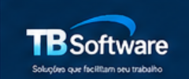

<div align="center">



# TB Software

### Sistema Desktop de Gestão de Clientes

Aplicação desktop desenvolvida em **Python**, com **Tkinter/ttk** e **SQLite**, criada como projeto prático de portefólio.

[](https://github.com/tiagomacielbr/TB_Software/actions)
[](https://github.com/tiagomacielbr/TB_Software/releases)
[](https://www.python.org/)

</div>

---

## 📌 Sobre o projeto

O **TB Software** é uma aplicação desktop de gestão de clientes que reúne, numa única solução local, funcionalidades de:

- gestão de clientes;
- autenticação e permissões;
- histórico de atendimentos;
- lembretes;
- relatórios;
- exportação de dados;
- backups e restauração;
- auditoria;
- configurações da aplicação.

O projeto foi desenvolvido para demonstrar não apenas programação em Python, mas também **organização de software, persistência de dados, segurança, testes, versionamento, CI/CD e distribuição para Windows**.

---

## 🚀 Funcionalidades

### 👥 Gestão de clientes

- Cadastro de clientes
- Pesquisa, edição e remoção
- Suporte para particulares e empresas
- Validação de NIF
- Consulta por NIF ou passaporte
- Histórico de atendimento

### 🔐 Autenticação e segurança

- Login de utilizadores
- Perfis e permissões
- Configuração do primeiro Administrador na primeira execução
- Passwords protegidas com **PBKDF2 + salt aleatório**
- Recuperação de password com código temporário de utilização única
- Compatibilidade com hashes anteriores durante migração

### 📊 Relatórios e acompanhamento

- Dashboard com indicadores
- Relatórios com filtros por período
- Clientes por país
- Clientes por localidade
- Clientes por tipo
- Novos clientes por mês
- Lembretes e notificações
- Histórico e auditoria

### 📤 Exportação

- CSV
- Excel
- PDF

### 💾 Dados e backups

- SQLite local
- Inicialização automática da estrutura
- Migrações de schema
- Integridade referencial
- Criação de backups
- Restauração de backups
- Base de dados local configurável para testes

---

## 🖥️ Interface

O sistema utiliza uma interface desktop com navegação lateral e áreas específicas para cada função.

### Dashboard


> As imagens de demonstração devem utilizar apenas dados fictícios. Caso uma imagem de demonstração não esteja disponível no repositório, consulte a aplicação diretamente.

### Principais áreas

- Início / Dashboard
- Clientes
- Relatórios
- Lembretes
- Utilizadores
- Dados e Segurança
- Configurações
- Pesquisa de clientes

---

## 🛠️ Tecnologias

| Tecnologia | Utilização |
|---|---|
| **Python 3.13** | Linguagem principal |
| **Tkinter / ttk** | Interface gráfica desktop |
| **SQLite** | Persistência local |
| **hashlib / secrets** | Segurança e geração de credenciais |
| **Pillow** | Recursos gráficos |
| **openpyxl** | Exportação para Excel |
| **ReportLab** | Geração de PDF |
| **pytest** | Testes automatizados |
| **Git / GitHub** | Versionamento |
| **GitHub Actions** | CI/CD |
| **PyInstaller** | Geração do executável Windows |

---

## 🏗️ Arquitetura atual

A aplicação encontra-se atualmente numa arquitetura **monolítica**, com a maior parte da interface e lógica de negócio concentrada em:

`interface_clientes.py`

O acesso à base de dados está centralizado em:

`banco.py`

O módulo `clientes.py` contém funções auxiliares relacionadas com validação e consulta de clientes.

Os recursos gráficos encontram-se em:

`assets/`

e a documentação técnica em:

`docs/`

### Documentação técnica

- [Arquitetura](docs/ARCHITECTURE.md)
- [Revisão técnica](docs/PROJECT_REVIEW.md)
- [Roadmap](docs/ROADMAP.md)
- [Guia de apresentação técnica](docs/PORTFOLIO.md)

---

## 📂 Estrutura do projeto

```text
TB_Software/
├── .github/
│   └── workflows/
│       ├── ci.yml
│       └── release.yml
├── assets/
├── docs/
├── tests/
├── interface_clientes.py
├── banco.py
├── clientes.py
├── requirements.txt
├── requirements-dev.txt
├── .gitignore
├── LICENSE
└── README.md
```

---

## 💻 Instalação no Windows

Clone o projeto:

```powershell
git clone https://github.com/tiagomacielbr/TB_Software.git
cd TB_Software
```

Crie e ative um ambiente virtual:

```powershell
py -m venv .venv
.\.venv\Scripts\Activate.ps1
```

Instale as dependências:

```powershell
python -m pip install --upgrade pip
pip install -r requirements-dev.txt
```

Execute a aplicação:

```powershell
python interface_clientes.py
```

> O projeto foi desenvolvido para Windows. O Tkinter precisa estar disponível na instalação do Python.

---

## 🧪 Testes

Execute a suíte de testes:

```powershell
python -m pytest tests -q
```

A suíte atual cobre, entre outros pontos:

- inicialização da base de dados;
- criação das tabelas;
- integridade SQLite;
- validação de NIF;
- hash de passwords;
- compatibilidade com hash legado;
- códigos de recuperação;
- migrações de schema;
- criação e validação de backups;
- verificação de sintaxe Python.

Os testes utilizam bases SQLite temporárias para evitar alterar os dados reais do utilizador.

---

## 🔄 Integração contínua

O projeto utiliza **GitHub Actions** para executar os testes automaticamente.

O workflow de CI:

1. prepara um ambiente Windows;
2. instala Python 3.13;
3. instala as dependências;
4. executa `pytest`.

O CI é executado em alterações na branch principal e em Pull Requests para `main`.

---

## 📦 Release Windows

O projeto possui um workflow específico para criação do executável Windows.

Quando uma tag no formato:

`v*`

é publicada, o GitHub Actions:

1. instala as dependências;
2. executa os testes;
3. instala PyInstaller;
4. gera `TB_Software.exe`;
5. publica o executável na GitHub Release.

### Versão atual

**TB Software v1.0.2**

[Ver releases](https://github.com/tiagomacielbr/TB_Software/releases)

---

## 🔐 Dados e privacidade

A base de dados local e os backups **não devem ser publicados no repositório**.

O `.gitignore` exclui ficheiros como:

```text
*.db
*.sqlite
*.sqlite3
backups/
.venv/
__pycache__/
.env
```

Durante demonstrações, entrevistas e screenshots devem ser utilizados exclusivamente **dados fictícios**.

A aplicação não cria automaticamente uma conta `admin` com uma password conhecida. O primeiro Administrador é configurado pelo utilizador.

---

## ⚠️ Limitações conhecidas

O TB Software é uma versão funcional de portefólio em evolução.

Pontos que ainda podem ser melhorados:

- aumentar a cobertura de testes de CRUD;
- ampliar testes de permissões, exportações e restauração;
- executar mais testes manuais de regressão no Windows;
- refatorar gradualmente `interface_clientes.py`;
- separar acesso a dados, validação, exportação e interface em módulos menores;
- avaliar proteção adicional dos dados em repouso.

Estas tarefas estão organizadas no [Roadmap](docs/ROADMAP.md).

---

## 🗺️ Roadmap

### Concluído

- Organização do projeto
- `.gitignore`
- Documentação inicial
- SQLite centralizado
- Inicialização segura da base
- Primeiro Administrador configurável
- Segurança de passwords
- Backups
- Testes automatizados
- GitHub Actions
- CI
- Build Windows com PyInstaller
- GitHub Release
- Licença MIT

### Próximos passos

- Aumentar cobertura de testes
- Testar fluxos completos de CRUD
- Testar permissões e exportações
- Testar restauração de backups
- Refatorar gradualmente o módulo principal
- Adicionar mais screenshots com dados fictícios

---

## 🎯 Objetivo de portefólio

O TB Software foi desenvolvido para demonstrar competências práticas em:

- **Python**
- **SQL / SQLite**
- **Tkinter**
- **Autenticação e segurança**
- **Manipulação de ficheiros**
- **Tratamento de erros**
- **Testes automatizados**
- **Git / GitHub**
- **GitHub Actions / CI/CD**
- **Documentação técnica**
- **Manutenção e evolução incremental de software**

O objetivo é demonstrar capacidade de trabalhar com um software real em evolução, e não apenas criar scripts isolados.

---

## 🎤 Como apresentar o projeto

Uma explicação curta para uma entrevista:

> "Este é o TB Software, uma aplicação desktop que desenvolvi em Python para gestão de clientes. Utilizei Tkinter para a interface e SQLite para persistência. Além do CRUD de clientes, implementei autenticação, permissões, recuperação de password, auditoria, histórico, lembretes, relatórios, exportações e backups. Também criei testes automatizados, integração contínua com GitHub Actions e um pipeline para gerar o executável Windows. O projeto está documentado e possui um roadmap para evolução e refatoração."

---

## 👨‍💻 Autor

**Tiago Rogerio Santos Maciel**

Projeto desenvolvido como portefólio para demonstrar evolução prática em programação e preparação para oportunidades profissionais na área de tecnologia.

---

## 📄 Licença

Este projeto está licenciado sob a **MIT License**.

Consulte o arquivo [LICENSE](LICENSE) para obter os termos completos.
